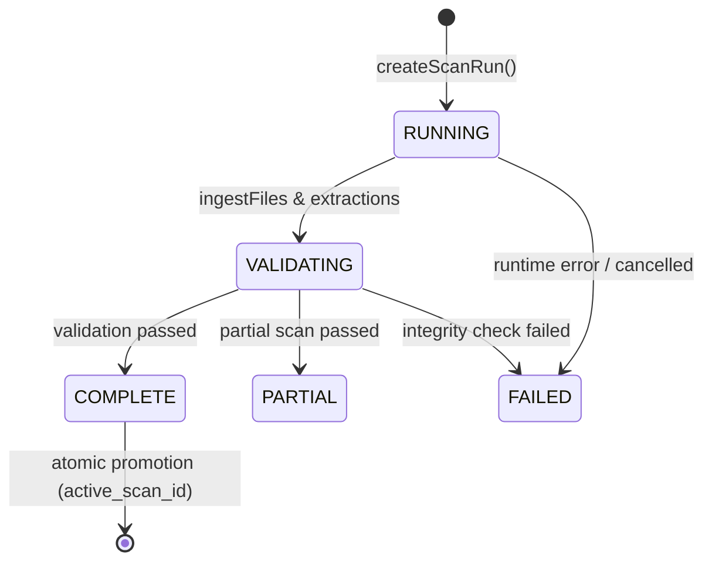

# Part 34: Storage Subsystem Architecture

## Overview

The Frontier Engineer Storage Subsystem provides durable, relational persistence for repository inventory, extracted syntax symbols, module import/export topologies, and engineering graph entities. It bridges the in-memory scanner (Phase 7.1) and structural extractors (Phase 7.2) to support cross-session queries, incremental analysis, and deterministic architecture intelligence.

All persistence is local to the project workspace and adheres strictly to Frontier's privacy, security, and isolation principles.

## Database Location & Layout

Persisted intelligence is located within the workspace under `.frontier/`:

```text
.frontier/
  intelligence/
    index.sqlite         # Primary SQLite database file
    index.sqlite-wal     # SQLite Write-Ahead Log
    index.sqlite-shm     # SQLite shared memory index
    metadata.json        # Workspace identity and root path metadata
    backups/             # Reserved for future snapshot backups
```

### Exclusions & Boundaries

1. **Scanner Exclusion:** `.frontier/` is permanently excluded from scanner discovery and inventory collation by the Phase 7.1 ignore evaluator and repository scanner.
2. **Version Control:** `.frontier/` is git-ignored and never committed to source control.
3. **Sandbox Bounding:** Database paths are strictly validated against directory traversal and symlink redirection. All database operations must resolve inside the workspace root.
4. **No Raw Source Persistence:** Source code text, file bodies, secrets, and raw credentials are never persisted in the database.

## SQLite Implementation & Operational Configuration

Frontier Engineer adopts Node.js built-in `node:sqlite` (`DatabaseSync`) as documented in [ADR-007](adr/ADR-007-storage-and-graph-engine.md).

### Runtime Configuration

- **Driver:** `node:sqlite` (`DatabaseSync`), native C-engine embedded in Node.js (>= 22.13.0).
- **Foreign Keys:** `PRAGMA foreign_keys = ON;` enforced on every database connection.
- **Journal Mode:** `PRAGMA journal_mode = WAL;` (Write-Ahead Logging) for high concurrency and crash resilience.
- **Synchronous:** `PRAGMA synchronous = NORMAL;` for optimal durability without disk bottlenecks.
- **Locking & Busy Timeout:** `PRAGMA busy_timeout = 5000;` (5-second lock acquisition timeout).

## Relational Schema & Migration Strategy

### Schema Versions & Migrations

Database migrations are versioned, sequential, and transactional. The `schema_migrations` table tracks applied migrations.

#### Schema Version 1 (`001-initial-schema.sql`)

Initial baseline intelligence tables: `schema_migrations`, `repositories`, `scan_runs`, `files`, `symbols`, `source_evidence`, `imports`, `exports`, `graph_nodes`, `graph_edges`, and `architecture_components`.

#### Schema Version 2 (`002-composite-foreign-keys.sql`)

Tightens relational isolation across all scan-owned entities. Recreates `symbols`, `source_evidence`, `imports`, `exports`, `graph_nodes`, `graph_edges`, and `architecture_components` with composite foreign keys enforcing that all child entities must reference parents within the exact same `(repository_id, scan_id)`.

```text
repositories (1) <---+
                     | (1:N)
scan_runs (N) <------+
  |
  +-- (composite FK) --> files (N)
  |                        |
  |                        +-- (composite FK) --> symbols (N)
  |                        |                        |
  |                        |                        +-- (composite self-FK) --> symbols (N)
  |                        |                        +-- (composite FK) --------> source_evidence (N)
  |                        |
  |                        +-- (composite FK) --> imports (N) [source_file & resolved_file]
  |                        +-- (composite FK) --> exports (N)
  |
  +-- (composite FK) --> graph_nodes (N) [file_id & symbol_id]
  +-- (composite FK) --> graph_edges (N) [source_node_id, target_node_id & evidence_id]
  +-- (composite FK) --> architecture_components (N) [evidence_id]
```

### Composite Foreign-Key Isolation Model

To mathematically prevent cross-repository or cross-scan data contamination, every snapshot-owned entity uses composite foreign keys scoped to `(repository_id, scan_id)`:

1. **Scan Runs to Files:** `FOREIGN KEY(repository_id, scan_id) REFERENCES scan_runs(repository_id, id) ON DELETE CASCADE`
2. **Files to Symbols:** `FOREIGN KEY(repository_id, scan_id, file_id) REFERENCES files(repository_id, scan_id, id) ON DELETE CASCADE`
3. **Symbol Self-Reference:** `FOREIGN KEY(repository_id, scan_id, parent_symbol_id) REFERENCES symbols(repository_id, scan_id, id) ON DELETE CASCADE`
4. **Files & Symbols to Source Evidence:**
   - `FOREIGN KEY(repository_id, scan_id, file_id) REFERENCES files(repository_id, scan_id, id) ON DELETE CASCADE`
   - `FOREIGN KEY(repository_id, scan_id, symbol_id) REFERENCES symbols(repository_id, scan_id, id) ON DELETE CASCADE`
5. **Imports:**
   - `FOREIGN KEY(repository_id, scan_id, source_file_id) REFERENCES files(repository_id, scan_id, id) ON DELETE CASCADE`
   - `FOREIGN KEY(repository_id, scan_id, resolved_file_id) REFERENCES files(repository_id, scan_id, id) ON DELETE CASCADE`
   - `FOREIGN KEY(repository_id, scan_id, evidence_id) REFERENCES source_evidence(repository_id, scan_id, id) ON DELETE CASCADE`
6. **Exports:**
   - `FOREIGN KEY(repository_id, scan_id, file_id) REFERENCES files(repository_id, scan_id, id) ON DELETE CASCADE`
   - `FOREIGN KEY(repository_id, scan_id, symbol_id) REFERENCES symbols(repository_id, scan_id, id) ON DELETE CASCADE`
   - `FOREIGN KEY(repository_id, scan_id, evidence_id) REFERENCES source_evidence(repository_id, scan_id, id) ON DELETE CASCADE`
7. **Graph Nodes:**
   - `FOREIGN KEY(repository_id, scan_id, file_id) REFERENCES files(repository_id, scan_id, id) ON DELETE CASCADE`
   - `FOREIGN KEY(repository_id, scan_id, symbol_id) REFERENCES symbols(repository_id, scan_id, id) ON DELETE CASCADE`
8. **Graph Edges:**
   - `FOREIGN KEY(repository_id, scan_id, source_node_id) REFERENCES graph_nodes(repository_id, scan_id, id) ON DELETE CASCADE`
   - `FOREIGN KEY(repository_id, scan_id, target_node_id) REFERENCES graph_nodes(repository_id, scan_id, id) ON DELETE CASCADE`
   - `FOREIGN KEY(repository_id, scan_id, evidence_id) REFERENCES source_evidence(repository_id, scan_id, id) ON DELETE CASCADE`
9. **Architecture Components:**
   - `FOREIGN KEY(repository_id, scan_id, evidence_id) REFERENCES source_evidence(repository_id, scan_id, id) ON DELETE CASCADE`

#### Design Note: Why `ON DELETE CASCADE` Over `ON DELETE SET NULL`

In SQLite, `ON DELETE SET NULL` applied to a composite foreign key attempts to set all referencing columns (`repository_id`, `scan_id`, `target_id`) to `NULL`. Because `repository_id` and `scan_id` are `NOT NULL`, this causes a `NOT NULL constraint failed` runtime error. In Frontier Engineer, snapshot-owned entities are immutable and deleted only when an entire scan run is deleted. `ON DELETE CASCADE` cleanly purges all dependent scan entities without constraint failures.

#### SQLite Nullability Semantics

In SQLite, if any column of a composite foreign key is `NULL` (e.g. `parent_symbol_id IS NULL`, `resolved_file_id IS NULL`, or `evidence_id IS NULL`), SQLite satisfies the foreign key check. When the optional target column is populated with a non-null integer, SQLite enforces that `(repository_id, scan_id, target_id)` strictly matches the parent table, guaranteeing complete cross-scan isolation.

#### Pre-Migration Integrity Verification

Migration 002 includes an automated pre-check query that inspects all 10 snapshot foreign keys before executing table recreations. If any pre-existing record contains cross-scan references, the pre-check triggers a `CHECK(violation_count = 0)` failure and aborts the migration atomically via `ROLLBACK`, preserving database integrity.

## Transactional Snapshot Persistence

The snapshot engine ensures that an incomplete, failed, or cancelled scan never corrupts or replaces an existing valid index.

### Lifecycle States



1. **Staging:** All inventory, symbols, imports, exports, and graph entities are written under a new `scan_id` with status `RUNNING`.
2. **Integrity Validation:** Before promotion, `GraphValidator` checks for dangling edges, missing nodes, and foreign-key consistency.
3. **Atomic Promotion & Partial Snapshot Policy:**
   - **COMPLETE Scans:** Automatically promoted to `active_scan_id` upon passing graph validation.
   - **PARTIAL Scans:** Require explicit user opt-in (`allowPartialPromotion: true`) to be promoted. If a `COMPLETE` active scan already exists, the partial scan is **never** promoted even with opt-in, guaranteeing that a degraded scan never overwrites complete intelligence.
   - **CANCELLED & FAILED Scans:** Never promoted under any circumstances.
4. **Failure Preservation:** If any failure occurs, the scan is marked `FAILED` with an explicit reason. The previous `active_scan_id` remains active and untouched.
5. **Crash Recovery:** Interrupted scans (`RUNNING` or `VALIDATING` upon restart) are safely marked `FAILED` without data loss.

## Repository Identity Resolution

Frontier Engineer deterministically resolves and validates repository identity:

1. **Identity Derivation:** Uses `.frontier/intelligence/metadata.json` if valid. Otherwise, deterministically hashes `workspaceRoot` and `displayName`: `repo_${sha256(rootPath + displayName).slice(0, 16)}`.
2. **Move Detection:** When `rootPath` in `metadata.json` differs from current `workspaceRoot`, Frontier checks if the original path still exists and is active. If the original path is absent, it treats the workspace as moved and updates `repositories.root_path`.
3. **Copy / Clone Detection:** If the original workspace is still present and active at `metadata.rootPath`, Frontier detects a copy/clone, generates a fresh repository identity, and resets `metadata.json`.
4. **Unrelated Project Replacement:** If `metadata.projectSignature` does not match the current workspace project signature, initialization aborts with `RepositoryIdentityConflictError` unless explicitly overridden.

## Security & Sensitive Content Rules

1. **Sensitive File Hashing:** If a file is classified as `sensitive` or its hash was withheld by the scanner (`SKIPPED_SENSITIVE`), its `content_hash` in the `files` table is stored as `NULL`.
2. **Evidence Sanitization:** Descriptions in `source_evidence` undergo automated redaction of passwords, private keys, and bearer tokens.
3. **No Dynamic Execution:** SQL queries never execute code extracted from repository files. Parameterized statements are used exclusively.
