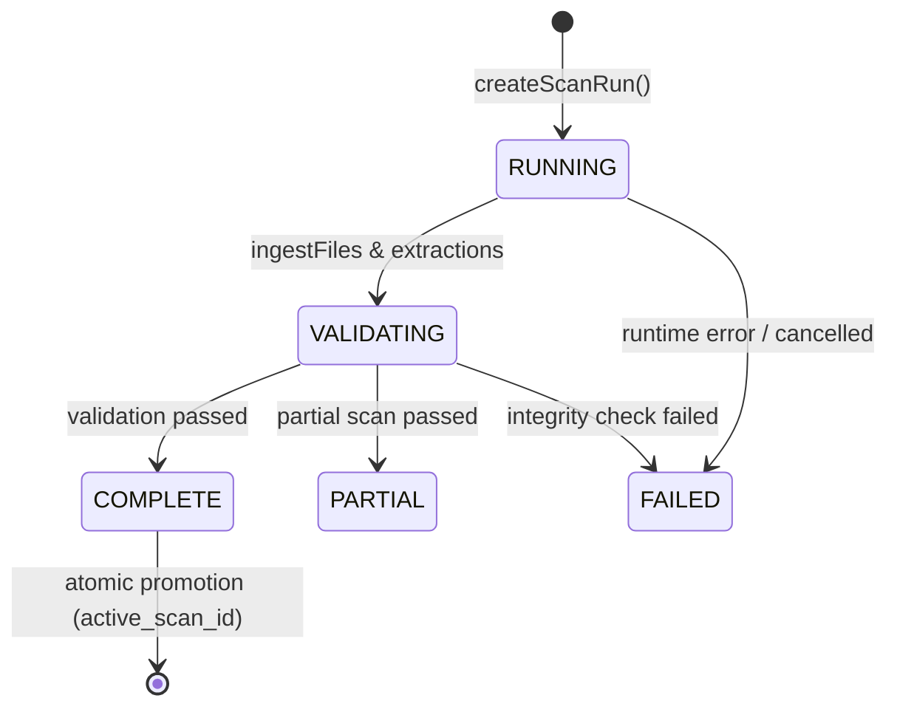

# Part 34: Storage Subsystem Architecture

## Overview

The Frontier Engineer Storage Subsystem provides durable, relational persistence for repository inventory, extracted syntax symbols, module import/export topologies, and engineering graph entities. It bridges the in-memory scanner (Phase 7.1) and structural extractors (Phase 7.2) to support cross-session queries, incremental analysis, and deterministic architecture intelligence.

All persistence is local to the project workspace and adheres strictly to Frontier's privacy, security, and isolation principles.

## Database Location & Layout

Persisted intelligence is located within the workspace under `.frontier/`:

```text
.frontier/
  intelligence/
    index.sqlite         # Primary SQLite database file
    index.sqlite-wal     # SQLite Write-Ahead Log
    index.sqlite-shm     # SQLite shared memory index
    metadata.json        # Workspace identity and root path metadata
    backups/             # Reserved for future snapshot backups
```

### Exclusions & Boundaries

1. **Scanner Exclusion:** `.frontier/` is permanently excluded from scanner discovery and inventory collation by the Phase 7.1 ignore evaluator and repository scanner.
2. **Version Control:** `.frontier/` is git-ignored and never committed to source control.
3. **Sandbox Bounding:** Database paths are strictly validated against directory traversal and symlink redirection. All database operations must resolve inside the workspace root.
4. **No Raw Source Persistence:** Source code text, file bodies, secrets, and raw credentials are never persisted in the database.

## SQLite Implementation & Operational Configuration

Frontier Engineer adopts Node.js built-in `node:sqlite` (`DatabaseSync`) as documented in [ADR-007](adr/ADR-007-storage-and-graph-engine.md).

### Runtime Configuration

- **Driver:** `node:sqlite` (`DatabaseSync`), native C-engine embedded in Node.js (>= 22.13.0).
- **Foreign Keys:** `PRAGMA foreign_keys = ON;` enforced on every database connection.
- **Journal Mode:** `PRAGMA journal_mode = WAL;` (Write-Ahead Logging) for high concurrency and crash resilience.
- **Synchronous:** `PRAGMA synchronous = NORMAL;` for optimal durability without disk bottlenecks.
- **Locking & Busy Timeout:** `PRAGMA busy_timeout = 5000;` (5-second lock acquisition timeout).

## Relational Schema & Migration Strategy

Database migrations are versioned, sequential, and transactional. The `schema_migrations` table tracks applied migrations.

### Schema Version 1 (`001-initial-schema.sql`)

```text
repositories (1) <---+
                     | (1:N)
scan_runs (N) <------+
  |
  +-- (composite FK) --> files (N)
  |                        |
  |                        +-- (composite FK) --> symbols (N)
  |                        |                        |
  |                        |                        +-- (composite FK) --> source_evidence (N)
  |                        |
  |                        +-- (composite FK) --> imports (N)
  |                        +-- (composite FK) --> exports (N)
  |
  +-- (composite FK) --> graph_nodes (N)
  +-- (composite FK) --> graph_edges (N)
  +-- (composite FK) --> architecture_components (N)
```

### Composite Foreign-Key Isolation

To mathematically prevent cross-repository or cross-scan data leakage, entity tables employ composite foreign keys referencing `(repository_id, scan_id)`:

```sql
FOREIGN KEY(repository_id, scan_id) REFERENCES scan_runs(repository_id, id) ON DELETE CASCADE
```

And symbols reference files scoped by repository and scan:

```sql
FOREIGN KEY(repository_id, scan_id, file_id) REFERENCES files(repository_id, scan_id, id) ON DELETE CASCADE
```

This ensures that a symbol in scan $A$ cannot reference a file in scan $B$ or a file from an unrelated repository.

## Transactional Snapshot Persistence

The snapshot engine ensures that an incomplete, failed, or cancelled scan never corrupts or replaces an existing valid index.

### Lifecycle States



1. **Staging:** All inventory, symbols, imports, exports, and graph entities are written under a new `scan_id` with status `RUNNING`.
2. **Integrity Validation:** Before promotion, `GraphValidator` checks for dangling edges, missing nodes, and foreign-key consistency.
3. **Atomic Promotion:** The database pointer `repositories.active_scan_id` is updated in an immediate transaction (`BEGIN IMMEDIATE`).
4. **Failure Preservation:** If any failure occurs, the scan is marked `FAILED` with an explicit reason. The previous `active_scan_id` remains active and untouched.
5. **Crash Recovery:** Interrupted scans (`RUNNING` or `VALIDATING` upon restart) are safely marked `FAILED` without data loss.

## Security & Sensitive Content Rules

1. **Sensitive File Hashing:** If a file is classified as `sensitive` or its hash was withheld by the scanner (`SKIPPED_SENSITIVE`), its `content_hash` in the `files` table is stored as `NULL`.
2. **Evidence Sanitization:** Descriptions in `source_evidence` undergo automated redaction of passwords, private keys, and bearer tokens.
3. **No Dynamic Execution:** SQL queries never execute code extracted from repository files. Parameterized statements are used exclusively.
