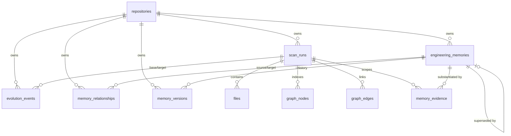
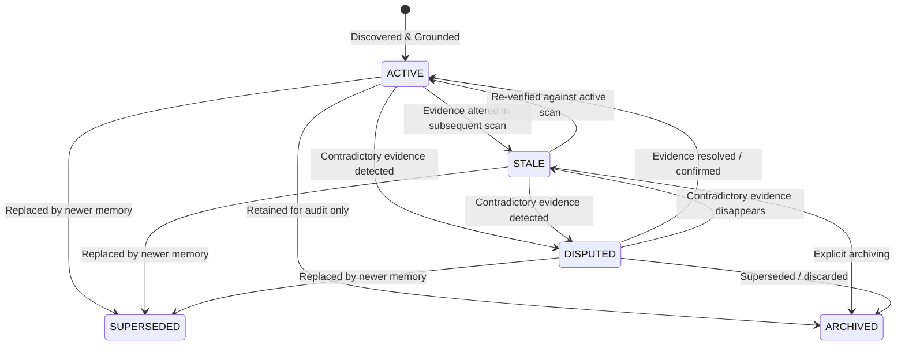

# Engineering Memory Data Model

This document specifies the persistent data model, relational constraints, isolation boundaries, trigger guards, and forward-only migration sequence for Phase 7.5: **Engineering Memory & Repository Evolution Intelligence**.

---

## 1. Objectives and Principles

Frontier Engineer preserves engineering knowledge and tracks repository evolution across multiple indexed snapshots. Unlike ephemeral conversational state or ungrounded generative summaries, engineering memory in Frontier Engineer is:

- **Persistent**: Survives application restarts and CLI invocations across sessions.
- **Repository-Scoped**: Strictly isolated per repository identity; cross-repository reads or relationships are rejected at the SQLite engine layer.
- **Evidence-Backed**: Grounded in verifiable AST symbols, canonical file paths, graph edges, and architectural records.
- **Versioned & Immutable**: Every content modification generates an immutable version record with cryptographic hashes and change rationale. Direct SQL update or deletion of historical versions is prohibited by database triggers.
- **Relational Integrity First**: Core safety constraints (composite foreign keys, check constraints, non-self-references, lifecycle status transitions, and version immutability) are enforced by the database engine rather than relying solely on application-level checks.



---

## 2. Entity Definitions & Table Schema

### 2.1 `engineering_memories`

Represents a unit of durable engineering knowledge.

```sql
CREATE TABLE IF NOT EXISTS engineering_memories (
  id INTEGER PRIMARY KEY AUTOINCREMENT,
  repository_id INTEGER NOT NULL REFERENCES repositories(id) ON DELETE CASCADE,
  memory_key TEXT NOT NULL,
  category TEXT NOT NULL CHECK(category IN (
    'architectural_knowledge',
    'engineering_convention',
    'architectural_decision',
    'technical_debt',
    'project_context',
    'evolution_record'
  )),
  title TEXT NOT NULL,
  content TEXT NOT NULL,
  confidence REAL NOT NULL CHECK(confidence >= 0.0 AND confidence <= 1.0),
  confidence_tier TEXT NOT NULL CHECK(confidence_tier IN ('CONFIRMED', 'INFERRED', 'CANDIDATE', 'UNRESOLVED')),
  status TEXT NOT NULL CHECK(status IN ('ACTIVE', 'STALE', 'SUPERSEDED', 'DISPUTED', 'ARCHIVED')),
  first_seen_scan_id INTEGER NULL,
  last_seen_scan_id INTEGER NULL,
  superseded_by_id INTEGER NULL,
  version INTEGER NOT NULL DEFAULT 1 CHECK(version >= 1),
  created_at TEXT NOT NULL,
  updated_at TEXT NOT NULL,
  last_verified_at TEXT NOT NULL,
  UNIQUE(repository_id, memory_key),
  UNIQUE(repository_id, id),
  CHECK(superseded_by_id IS NULL OR superseded_by_id != id),
  FOREIGN KEY(repository_id, superseded_by_id) REFERENCES engineering_memories(repository_id, id) ON DELETE CASCADE,
  FOREIGN KEY(repository_id, first_seen_scan_id) REFERENCES scan_runs(repository_id, id) ON DELETE RESTRICT,
  FOREIGN KEY(repository_id, last_seen_scan_id) REFERENCES scan_runs(repository_id, id) ON DELETE RESTRICT
);
```

#### Fields

| Field                | Type                  | Description                                                                 |
| :------------------- | :-------------------- | :-------------------------------------------------------------------------- |
| `id`                 | `INTEGER PRIMARY KEY` | Internal surrogate primary key.                                             |
| `repository_id`      | `INTEGER`             | Owning repository ID (composite isolation root).                            |
| `memory_key`         | `TEXT`                | Stable, deterministic key unique per repository.                            |
| `category`           | `TEXT`                | One of the 6 engineering memory categories.                                 |
| `title`              | `TEXT`                | Concise summary of the memory.                                              |
| `content`            | `TEXT`                | Grounded markdown or text statement.                                        |
| `confidence`         | `REAL`                | Confidence score between 0.0 and 1.0.                                       |
| `confidence_tier`    | `TEXT`                | `CONFIRMED`, `INFERRED`, `CANDIDATE`, or `UNRESOLVED`.                      |
| `status`             | `TEXT`                | Lifecycle status (`ACTIVE`, `STALE`, `SUPERSEDED`, `DISPUTED`, `ARCHIVED`). |
| `first_seen_scan_id` | `INTEGER NULL`        | Scan run in which this memory was first identified.                         |
| `last_seen_scan_id`  | `INTEGER NULL`        | Most recent scan run validating this memory.                                |
| `superseded_by_id`   | `INTEGER NULL`        | Reference to replacing memory within the same repository.                   |
| `version`            | `INTEGER`             | Current version sequence counter (starts at 1).                             |
| `created_at`         | `TEXT`                | ISO-8601 creation timestamp.                                                |
| `updated_at`         | `TEXT`                | ISO-8601 last update timestamp.                                             |
| `last_verified_at`   | `TEXT`                | ISO-8601 timestamp of last verification against evidence.                   |

---

### 2.2 `memory_evidence`

Binds a memory to specific, verifiable source code or architectural artifacts in a specific scan run.

```sql
CREATE TABLE IF NOT EXISTS memory_evidence (
  id INTEGER PRIMARY KEY AUTOINCREMENT,
  repository_id INTEGER NOT NULL,
  memory_id INTEGER NOT NULL,
  scan_id INTEGER NOT NULL,
  evidence_type TEXT NOT NULL CHECK(evidence_type IN (
    'source_file',
    'symbol',
    'import',
    'component',
    'adr',
    'graph_edge',
    'test',
    'diff',
    'manual'
  )),
  source_path TEXT NOT NULL,
  line_start INTEGER NULL CHECK(line_start IS NULL OR line_start >= 1),
  line_end INTEGER NULL CHECK(line_end IS NULL OR line_end >= line_start),
  source_hash TEXT NULL,
  symbol_identity TEXT NULL,
  graph_node_id INTEGER NULL,
  graph_edge_id INTEGER NULL,
  description TEXT NOT NULL,
  confidence REAL NOT NULL CHECK(confidence >= 0.0 AND confidence <= 1.0),
  is_contradictory INTEGER NOT NULL DEFAULT 0 CHECK(is_contradictory IN (0, 1)),
  created_at TEXT NOT NULL,
  UNIQUE(repository_id, scan_id, id),
  FOREIGN KEY(repository_id, memory_id) REFERENCES engineering_memories(repository_id, id) ON DELETE CASCADE,
  FOREIGN KEY(repository_id, scan_id) REFERENCES scan_runs(repository_id, id) ON DELETE CASCADE,
  FOREIGN KEY(repository_id, scan_id, graph_node_id) REFERENCES graph_nodes(repository_id, scan_id, id) ON DELETE CASCADE,
  FOREIGN KEY(repository_id, scan_id, graph_edge_id) REFERENCES graph_edges(repository_id, scan_id, id) ON DELETE CASCADE
);
```

---

### 2.3 `evolution_events`

Records architectural and structural changes between two distinct scans of the same repository.

```sql
CREATE TABLE IF NOT EXISTS evolution_events (
  id INTEGER PRIMARY KEY AUTOINCREMENT,
  repository_id INTEGER NOT NULL,
  base_scan_id INTEGER NOT NULL,
  target_scan_id INTEGER NOT NULL,
  event_type TEXT NOT NULL,
  category TEXT NOT NULL CHECK(category IN ('file', 'symbol', 'dependency', 'architecture', 'decision', 'debt')),
  title TEXT NOT NULL,
  description TEXT NOT NULL,
  severity TEXT NOT NULL CHECK(severity IN ('INFO', 'LOW', 'MEDIUM', 'HIGH', 'CRITICAL')),
  confidence REAL NOT NULL CHECK(confidence >= 0.0 AND confidence <= 1.0),
  confidence_tier TEXT NOT NULL CHECK(confidence_tier IN ('CONFIRMED', 'INFERRED', 'CANDIDATE')),
  details_json TEXT NULL,
  created_at TEXT NOT NULL,
  CHECK(base_scan_id != target_scan_id),
  FOREIGN KEY(repository_id, base_scan_id) REFERENCES scan_runs(repository_id, id) ON DELETE CASCADE,
  FOREIGN KEY(repository_id, target_scan_id) REFERENCES scan_runs(repository_id, id) ON DELETE CASCADE
);
```

---

### 2.4 `memory_relationships`

Directed relationships connecting memories within the same repository.

```sql
CREATE TABLE IF NOT EXISTS memory_relationships (
  id INTEGER PRIMARY KEY AUTOINCREMENT,
  repository_id INTEGER NOT NULL,
  source_memory_id INTEGER NOT NULL,
  target_memory_id INTEGER NOT NULL,
  relationship_type TEXT NOT NULL CHECK(relationship_type IN (
    'IMPLEMENTS',
    'SUPERSEDES',
    'CONTRADICTS',
    'RELATES_TO',
    'DOCUMENTS',
    'DEPENDS_ON'
  )),
  created_at TEXT NOT NULL,
  CHECK(source_memory_id != target_memory_id),
  UNIQUE(repository_id, source_memory_id, target_memory_id, relationship_type),
  FOREIGN KEY(repository_id, source_memory_id) REFERENCES engineering_memories(repository_id, id) ON DELETE CASCADE,
  FOREIGN KEY(repository_id, target_memory_id) REFERENCES engineering_memories(repository_id, id) ON DELETE CASCADE
);
```

---

### 2.5 `memory_versions`

Immutable historical revisions for all memories. Whenever a memory's content or lifecycle state changes, a corresponding revision is persisted.

```sql
CREATE TABLE IF NOT EXISTS memory_versions (
  id INTEGER PRIMARY KEY AUTOINCREMENT,
  repository_id INTEGER NOT NULL,
  memory_id INTEGER NOT NULL,
  version INTEGER NOT NULL CHECK(version >= 1),
  title TEXT NOT NULL,
  content TEXT NOT NULL,
  status TEXT NOT NULL CHECK(status IN ('ACTIVE', 'STALE', 'SUPERSEDED', 'DISPUTED', 'ARCHIVED')),
  previous_content_hash TEXT NULL,
  new_content_hash TEXT NOT NULL,
  change_reason TEXT NOT NULL,
  source_scan_id INTEGER NULL,
  created_at TEXT NOT NULL,
  UNIQUE(memory_id, version),
  FOREIGN KEY(repository_id, memory_id) REFERENCES engineering_memories(repository_id, id) ON DELETE CASCADE,
  FOREIGN KEY(repository_id, source_scan_id) REFERENCES scan_runs(repository_id, id) ON DELETE RESTRICT
);
```

---

### 2.6 Database Triggers

Migration 003 installs five database triggers to enforce immutability, initial lifecycle states, transition guards, and supersession integrity directly at the SQLite engine level:

```sql
-- 1. Disallow direct UPDATE on existing memory versions
CREATE TRIGGER IF NOT EXISTS trg_memory_versions_no_update
BEFORE UPDATE ON memory_versions
BEGIN
  SELECT RAISE(ABORT, 'memory_versions records are immutable and cannot be updated');
END;

-- 2. Disallow direct DELETE on memory versions while parent memory exists
CREATE TRIGGER IF NOT EXISTS trg_memory_versions_no_direct_delete
BEFORE DELETE ON memory_versions
WHEN (SELECT COUNT(*) FROM engineering_memories WHERE id = OLD.memory_id) > 0
BEGIN
  SELECT RAISE(ABORT, 'Direct deletion of memory_versions is prohibited; versions are immutable');
END;

-- 3. Enforce valid initial state on newly created memories
CREATE TRIGGER IF NOT EXISTS trg_engineering_memories_insert_guard
BEFORE INSERT ON engineering_memories
FOR EACH ROW
BEGIN
  SELECT CASE
    WHEN NEW.status != 'ACTIVE' THEN
      RAISE(ABORT, 'Illegal initial status: newly created memories must start in ACTIVE status')
    WHEN NEW.superseded_by_id IS NOT NULL THEN
      RAISE(ABORT, 'Illegal initial state: newly created memories cannot specify superseded_by_id')
    WHEN NEW.version != 1 THEN
      RAISE(ABORT, 'Illegal initial version: newly created memories must start at version 1')
  END;
END;

-- 4. Enforce lifecycle transitions, terminal states, and supersession invariants
CREATE TRIGGER IF NOT EXISTS trg_engineering_memories_update_guard
BEFORE UPDATE ON engineering_memories
FOR EACH ROW
BEGIN
  -- Terminal statuses & supersession immutability
  SELECT CASE
    WHEN OLD.status = 'SUPERSEDED' AND NEW.status != 'SUPERSEDED' THEN
      RAISE(ABORT, 'Illegal status transition: SUPERSEDED is a terminal state and cannot be reactivated or changed')
    WHEN OLD.status = 'SUPERSEDED' AND (NEW.superseded_by_id IS NULL OR NEW.superseded_by_id != OLD.superseded_by_id) THEN
      RAISE(ABORT, 'Illegal supersession mutation: a SUPERSEDED memory cannot change or clear its replacement')
    WHEN OLD.status = 'ARCHIVED' AND NEW.status != 'ARCHIVED' THEN
      RAISE(ABORT, 'Illegal status transition: ARCHIVED is a terminal state and cannot be reactivated or changed')
    WHEN OLD.status = 'ARCHIVED' AND NEW.superseded_by_id IS NOT NULL THEN
      RAISE(ABORT, 'Illegal state: an ARCHIVED memory cannot specify superseded_by_id')
  END;

  -- Allowable transitions
  SELECT CASE
    WHEN OLD.status = 'ACTIVE' AND NEW.status NOT IN ('ACTIVE', 'STALE', 'DISPUTED', 'SUPERSEDED', 'ARCHIVED') THEN
      RAISE(ABORT, 'Illegal status transition from ACTIVE')
    WHEN OLD.status = 'STALE' AND NEW.status NOT IN ('STALE', 'ACTIVE', 'DISPUTED', 'SUPERSEDED', 'ARCHIVED') THEN
      RAISE(ABORT, 'Illegal status transition from STALE')
    WHEN OLD.status = 'DISPUTED' AND NEW.status NOT IN ('DISPUTED', 'ACTIVE', 'STALE', 'SUPERSEDED', 'ARCHIVED') THEN
      RAISE(ABORT, 'Illegal status transition from DISPUTED')
  END;

  -- Non-SUPERSEDED memories cannot have superseded_by_id
  SELECT CASE
    WHEN NEW.status != 'SUPERSEDED' AND NEW.superseded_by_id IS NOT NULL THEN
      RAISE(ABORT, 'Illegal state: only SUPERSEDED memories can specify superseded_by_id')
  END;

  -- SUPERSEDED requirements
  SELECT CASE
    WHEN NEW.status = 'SUPERSEDED' AND NEW.superseded_by_id IS NULL THEN
      RAISE(ABORT, 'Illegal supersession: a SUPERSEDED memory must have a non-null superseded_by_id')
    WHEN NEW.status = 'SUPERSEDED' AND NEW.superseded_by_id = NEW.id THEN
      RAISE(ABORT, 'Illegal supersession: self-supersession is prohibited')
    WHEN NEW.status = 'SUPERSEDED' AND (
      SELECT status FROM engineering_memories
      WHERE repository_id = NEW.repository_id AND id = NEW.superseded_by_id
    ) IN ('SUPERSEDED', 'ARCHIVED') THEN
      RAISE(ABORT, 'Illegal supersession: replacement memory cannot be in SUPERSEDED or ARCHIVED status')
  END;
END;

-- 5. Disallow deleting replacement memories directly while referenced
CREATE TRIGGER IF NOT EXISTS trg_engineering_memories_no_delete_replacement
BEFORE DELETE ON engineering_memories
WHEN (SELECT COUNT(*) FROM repositories WHERE id = OLD.repository_id) > 0
  AND (SELECT COUNT(*) FROM engineering_memories WHERE superseded_by_id = OLD.id) > 0
BEGIN
  SELECT RAISE(ABORT, 'Illegal operation: cannot delete a memory that is currently a replacement for superseded memories');
END;
```

---

## 3. Relational Integrity & Isolation

### 3.1 Composite Foreign Key Policy

Frontier Engineer strictly enforces multi-tenant repository boundaries using composite keys:

1. **Same-Repository Isolation**: Any foreign key referencing an entity (memory, version, relationship, event) requires matching `repository_id` alongside the primary key:
   - `FOREIGN KEY(repository_id, memory_id) REFERENCES engineering_memories(repository_id, id)`
   - `FOREIGN KEY(repository_id, source_memory_id) REFERENCES engineering_memories(repository_id, id)`
   - `FOREIGN KEY(repository_id, target_memory_id) REFERENCES engineering_memories(repository_id, id)`
2. **Snapshot-Level Scope**: Evidence records referencing graph entities enforce identical repository and scan ownership:
   - `FOREIGN KEY(repository_id, scan_id, graph_node_id) REFERENCES graph_nodes(repository_id, scan_id, id)`
   - `FOREIGN KEY(repository_id, scan_id, graph_edge_id) REFERENCES graph_edges(repository_id, scan_id, id)`

### 3.2 Graph Edge Composite Parent Key Guarantee

`graph_nodes` has a native table constraint `UNIQUE(repository_id, scan_id, id)`. In migration 003, `CREATE UNIQUE INDEX IF NOT EXISTS idx_graph_edges_repo_scan_id ON graph_edges(repository_id, scan_id, id);` establishes the exact unique composite parent key on `graph_edges` required by SQLite for `memory_evidence(repository_id, scan_id, graph_edge_id)`.

### 3.3 Avoidance of Invalid Composite `SET NULL` and Cascade Paths

> [!WARNING]
> SQLite's `ON DELETE SET NULL` on a composite foreign key attempts to set **all** referenced columns to `NULL`. If the foreign key includes a `NOT NULL` column such as `repository_id`, SQLite raises an abort error (`NOT NULL constraint failed`).

To prevent integrity crashes and maintain clean cascade trees:

- Historical scan references (`first_seen_scan_id`, `last_seen_scan_id`, `source_scan_id`) specify `ON DELETE RESTRICT`. Deleting an older scan run is prevented as long as an active memory or version record references it.
- Supersession references (`superseded_by_id`) specify `FOREIGN KEY(repository_id, superseded_by_id) REFERENCES engineering_memories(repository_id, id) ON DELETE CASCADE`. Direct deletion of a replacement memory while referenced by active or superseded memories is prohibited by the trigger `trg_engineering_memories_no_delete_replacement`.
- Grandchild entities (`memory_versions`, `memory_relationships`) cascade exclusively through their immediate parent (`engineering_memories`). Direct redundant foreign keys from `repositories` were eliminated, avoiding multi-path cascade collisions during repository deletion.
- When a repository is deleted (`DELETE FROM repositories WHERE id = ?`), SQLite cascades down `repositories -> engineering_memories -> memory_versions`, cleanly pruning all descendants without trigger conflict (because `trg_engineering_memories_no_delete_replacement` detects that the parent repository no longer exists).
- Snapshot-scoped evidence (`memory_evidence`) specifies `ON DELETE CASCADE` from `scan_runs`. Deleting an unreferenced scan automatically prunes its evidence rows without corrupting the surviving `engineering_memories` records.

---

## 4. Memory Categories & Lifecycle

### 4.1 Memory Categories

| Category                  | Description                                                       | Example                                                                                      |
| :------------------------ | :---------------------------------------------------------------- | :------------------------------------------------------------------------------------------- |
| `architectural_knowledge` | Structural and system-level patterns confirmed by code analysis.  | "The application uses a modular SQLite repository pattern with composite foreign keys."      |
| `engineering_convention`  | Repeated conventions (naming, file layout, testing rules).        | "All unit tests live in `tests/unit/*.test.ts` and use vitest."                              |
| `architectural_decision`  | Documented architecture choices (linked to ADRs).                 | "ADR-007 mandates `node:sqlite` over native C++ bindings for zero-dependency portability."   |
| `technical_debt`          | Documented debt, circular dependencies, or deprecated interfaces. | "Cycle detected between `auth-service` and `session-manager` (severity: HIGH)."              |
| `project_context`         | Critical domain entrypoints, external service contracts.          | "CLI entrypoint is `scripts/cli/frontier-cli.ts` exposing exit codes 0 through 4."           |
| `evolution_record`        | Historical architectural milestone or refactoring event.          | "Storage layer upgraded from schema version 2 to version 3 with composite memory isolation." |

### 4.2 Lifecycle State Transitions

Memories transition through explicit lifecycle states:



- **ACTIVE**: Grounded by active snapshot evidence. Newly inserted memories must start in `ACTIVE` status.
- **STALE**: Associated evidence files or symbols were modified or relocated. Stale memories are marked with honest freshness warnings and cannot be asserted as current facts without re-verification.
- **DISPUTED**: Contradictory evidence exists (e.g. ADR claims a pattern, but AST analysis proves otherwise).
- **SUPERSEDED**: Explicitly superseded by another memory record (`superseded_by_id`). Terminal state.
- **ARCHIVED**: Historically preserved but inactive. Terminal state.

### 4.3 Initial State & Supersession Integrity Rules

1. **Initial State Enforcement**:
   - New memories must start in `ACTIVE` status.
   - `SUPERSEDED`, `ARCHIVED`, `STALE`, and `DISPUTED` cannot be initial statuses.
   - New memories cannot specify `superseded_by_id` (must be `NULL`).
   - New memories must start at `version = 1`.
   - Enforced by database trigger `trg_engineering_memories_insert_guard`.

2. **Supersession Integrity Invariants**:
   - **Replacement Required**: A memory cannot enter `SUPERSEDED` status without a non-null `superseded_by_id`.
   - **Repository Isolation**: The replacement memory must belong to the same repository (enforced by composite foreign key `(repository_id, superseded_by_id)`).
   - **No Self-Supersession**: A memory cannot supersede itself (`CHECK(superseded_by_id IS NULL OR superseded_by_id != id)` and trigger).
   - **Valid Replacement Status**: A replacement memory cannot be in `SUPERSEDED` or `ARCHIVED` status.
   - **Immutability of Supersession**: Once superseded, a memory cannot change or clear its `superseded_by_id` reference.
   - **Terminal Status**: A `SUPERSEDED` memory cannot be reactivated or transitioned to any other status.
   - **Replacement Retention**: A memory acting as a replacement for superseded memories cannot be deleted directly while referenced (`trg_engineering_memories_no_delete_replacement`).

3. **Atomic Historical Version History**:
   - Direct SQL mutations that bypass the storage API do not create version records. All production lifecycle writes must route through `MemoryStore.transitionLifecycle()`.
   - `MemoryStore.transitionLifecycle()` executes an immediate transaction:
     1. Validates requested transition and checks for no-op requests.
     2. Snapshots prior state into `memory_versions` with SHA-256 content hashes and change reason.
     3. Applies new status, version increment (`version = version + 1`), and updated timestamps.
     4. Commits atomically or rolls back all changes if any step or trigger fails.

---

## 5. Enforcement Boundaries & Responsibility Matrix

To maintain transparent architectural discipline, invariants are divided strictly by enforcement layer:

| Invariant                               | Enforcement Mechanism                                                                      | Layer                       | Stage     |
| :-------------------------------------- | :----------------------------------------------------------------------------------------- | :-------------------------- | :-------- |
| **Repository Multi-Tenant Isolation**   | Composite foreign keys `(repository_id, entity_id)`                                        | Database Engine (SQLite)    | Stage 2   |
| **Snapshot Evidence Scope**             | Composite foreign keys `(repository_id, scan_id, entity_id)`                               | Database Engine (SQLite)    | Stage 2   |
| **Memory Key Uniqueness**               | Table constraint `UNIQUE(repository_id, memory_key)`                                       | Database Engine (SQLite)    | Stage 2   |
| **Initial Memory Status (ACTIVE)**      | Database trigger `trg_engineering_memories_insert_guard`                                   | Database Engine (SQLite)    | Stage 2   |
| **Initial Version Sequence (1)**        | Database trigger `trg_engineering_memories_insert_guard`                                   | Database Engine (SQLite)    | Stage 2   |
| **Non-Self-Supersession**               | Table constraint `CHECK(superseded_by_id IS NULL OR superseded_by_id != id)`               | Database Engine (SQLite)    | Stage 2   |
| **Supersession Non-Null Replacement**   | Database trigger `trg_engineering_memories_update_guard`                                   | Database Engine (SQLite)    | Stage 2   |
| **Supersession Replacement Validity**   | Database trigger `trg_engineering_memories_update_guard`                                   | Database Engine (SQLite)    | Stage 2   |
| **Supersession Reference Immutability** | Database trigger `trg_engineering_memories_update_guard`                                   | Database Engine (SQLite)    | Stage 2   |
| **Replacement Deletion Protection**     | Database trigger `trg_engineering_memories_no_delete_replacement`                          | Database Engine (SQLite)    | Stage 2   |
| **Non-Self-Relationships**              | Table constraint `CHECK(source_memory_id != target_memory_id)`                             | Database Engine (SQLite)    | Stage 2   |
| **Distinct Evolution Scan Pairs**       | Table constraint `CHECK(base_scan_id != target_scan_id)`                                   | Database Engine (SQLite)    | Stage 2   |
| **Memory Version Immutability**         | Database triggers `trg_memory_versions_no_update` & `trg_memory_versions_no_direct_delete` | Database Engine (SQLite)    | Stage 2   |
| **Lifecycle Transition Graph**          | Database trigger `trg_engineering_memories_update_guard`                                   | Database Engine (SQLite)    | Stage 2   |
| **Historical Scan Retention**           | Composite foreign key `ON DELETE RESTRICT` on `first_seen_scan_id` & `source_scan_id`      | Database Engine (SQLite)    | Stage 2   |
| **Atomic Version Creation**             | Immediate transaction writing version row and advancing memory counter                     | Storage API (`MemoryStore`) | Stage 2.2 |
| **No-Op Status Redundancy Guard**       | Storage API idempotency check returning existing record without incrementing version       | Storage API (`MemoryStore`) | Stage 2.2 |
| **Chronological Evolution Order**       | Validation that `targetScan.startedAt >= baseScan.startedAt` before event emission         | Snapshot Comparator Layer   | Stage 3   |
| **Rename Detection Heuristic**          | Structural hash matching and fingerprint correlation                                       | Snapshot Comparator Layer   | Stage 3   |
| **Architectural Drift Analysis**        | Correlating ADR decisions with observed dependency graph changes                           | Evolution Analyzer Layer    | Stage 4   |

---

## 6. Confidence Model

Every memory and evidence row carries both a numeric score and an explicit confidence tier:

- **CONFIRMED** (`1.0`): Backed by deterministic AST or database constraints (e.g. table schema, explicit foreign key, exact code AST symbol).
- **INFERRED** (`0.70 - 0.99`): Derived through heuristic association (e.g. test association conventions, directory naming heuristics).
- **CANDIDATE** (`0.40 - 0.69`): Preliminary candidate finding requiring verification.
- **UNRESOLVED** (`0.00 - 0.39`): Ambiguous finding or unconfirmed pattern.

---

## 7. Migration Procedure & Unreleased Migration Approach

Migration `003-engineering-memory-evolution.sql` is registered in `scripts/storage/schema/migration-runner.ts` and advances `CURRENT_SCHEMA_VERSION` to `3`.

### 7.1 Unreleased Migration Scope

Frontier Engineer is currently version `0.6.3`. Phase 7.5 is under pre-release development targeting release `0.7.0` upon Phase 7 completion and acceptance.
Because Migration 003 is unreleased, incorporating trigger guards and foreign-key cascade adjustments directly into Migration 003 preserves forward-only discipline without cluttering the canonical schema history with interim, pre-release migrations, while maintaining `CURRENT_SCHEMA_VERSION = 3` as specified.

### 7.2 Transactional Execution

```typescript
db.exec("BEGIN IMMEDIATE;");
try {
  db.exec(migration003Sql);
  // Database checks FK integrity before committing
  const violations = db.prepare("PRAGMA foreign_key_check;").all();
  if (violations.length > 0) throw new Error("Violations detected");
  db.prepare("INSERT INTO schema_migrations (version, name, applied_at) VALUES (3, ?, ?)").run(
    name,
    now,
  );
  db.exec("COMMIT;");
} catch (err) {
  db.exec("ROLLBACK;");
  throw err;
}
```

### 7.2 Pre-Migration Integrity

Migration 003 does not alter or recreate existing tables (`repositories`, `scan_runs`, `files`, `symbols`, `source_evidence`, `imports`, `exports`, `graph_nodes`, `graph_edges`, `architecture_components`). It creates:

1. `idx_graph_edges_repo_scan_id` (enabling composite FKs from `memory_evidence` to `graph_edges`).
2. The 5 new tables (`engineering_memories`, `memory_evidence`, `evolution_events`, `memory_relationships`, `memory_versions`).
3. Targeted performance indexes.
4. Three database triggers enforcing immutability and lifecycle transitions.

---

## 8. Index Strategy & Performance

The following indexes were established and verified via `EXPLAIN QUERY PLAN`:

| Table                  | Index                                     | Primary Target Query                                    |
| :--------------------- | :---------------------------------------- | :------------------------------------------------------ |
| `engineering_memories` | `idx_memories_repo_cat_status`            | Filter memories by repository, category, and status.    |
| `engineering_memories` | `sqlite_autoindex_engineering_memories_1` | Deterministic key lookup `(repository_id, memory_key)`. |
| `memory_evidence`      | `idx_memory_evidence_memory`              | Evidence retrieval for a specific memory.               |
| `memory_evidence`      | `idx_memory_evidence_repo_scan`           | Evidence retrieval for a specific repository scan.      |
| `evolution_events`     | `idx_evolution_events_target`             | Evolution lookup for a target scan.                     |
| `evolution_events`     | `idx_evolution_events_base`               | Evolution lookup for a base scan.                       |
| `memory_relationships` | `idx_memory_relationships_source`         | Outgoing relationship traversal.                        |
| `memory_relationships` | `idx_memory_relationships_target`         | Incoming relationship traversal.                        |
| `memory_versions`      | `sqlite_autoindex_memory_versions_1`      | Exact version lookup `(memory_id, version)`.            |

Redundant secondary indexes were deliberately avoided:

- `(repository_id, memory_key)` and `(memory_id, version)` are covered by SQLite's automatic unique indexes.
- `(repository_id, id)` lookups utilize SQLite's `INTEGER PRIMARY KEY` rowid search.

---

## 9. Security & Privacy Guarantees

1. **Repository Boundary**: Cross-repository memory access, supersession, or relationships are rejected by SQLite composite foreign keys.
2. **Zero Secret Persistence**: Memory evidence records only reference canonical repository paths, line numbers, and symbol identities. Raw source contents, secret tokens, and sensitive files (as classified by `SensitiveFilter`) are strictly excluded from storage.
3. **Prompt Injection Resistance**: Memories are descriptive structural observations stored in relational tables. They are treated as untrusted repository data and never executed or evaluated as privileged instructions.
4. **Local Isolation**: SQLite persistence operates entirely on local disk (`.frontier/intelligence/index.sqlite` or in-memory `:memory:`). No external network egress or telemetry is utilized.

---

## 10. Known Limitations

- **Cross-Repository References Prohibited**: Multi-repository dependency graphs (e.g. monorepos spanning distinct repository identities) cannot share memories directly; each repository maintains independent memory isolation.
- **Historical Scan Pruning Constraint**: Deleting a historical scan run requires clearing foreign key references on surviving memories (`first_seen_scan_id`, `last_seen_scan_id`) to prevent violating `ON DELETE RESTRICT`.
- **Chronology Enforcement**: `evolution_events` table ensures scans are distinct, while strict chronological verification (`targetScan.startedAt >= baseScan.startedAt`) is enforced at the Stage 3 Snapshot-Comparator boundary.
